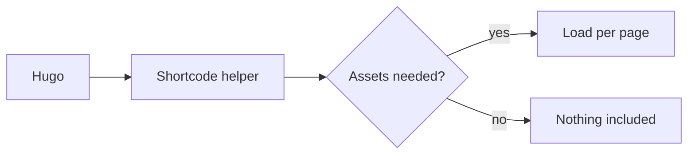

# mermaid

Renders the inner content into `<pre class="mermaid">` for client-side rendering by [Mermaid.js](https://mermaid.js.org/).



## Parameters

| Parameter | Type | Required | Purpose |
|---|---|---|---|
| `class` | string | no | Extra class on the `<pre>` element |

The inner content is the Mermaid diagram definition.

## Example

```text

graph TD
    A --> B

```

## Assets

Via the shortcode helper: JS `js/mermaid.js`.

## Errors

- `errorf "[shortcodes/mermaid/block.html] Empty content for mermaid in <page>"` when the inner content is empty
